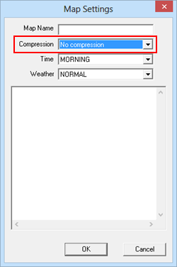
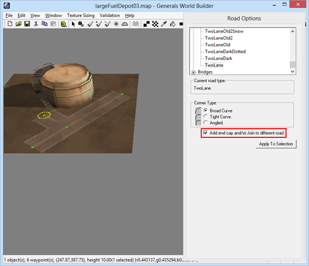
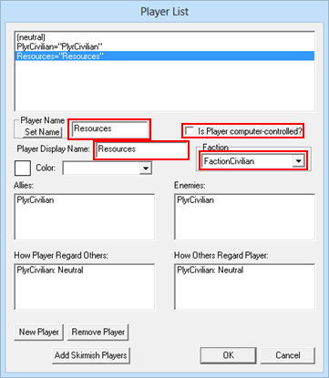
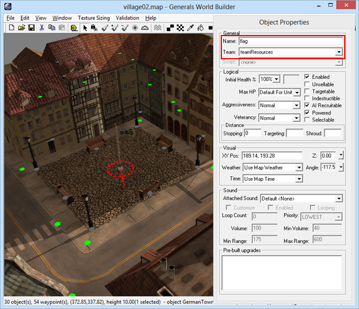
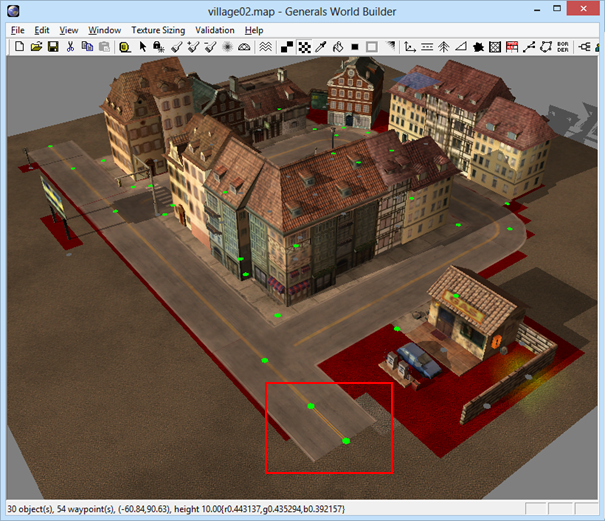

# Templates

Templates are pre-built areas consisting of multiple objects such as farms or small towns that can be inserted into a generated map. They are saved just as every other map and can be created using Worldbuilder.

At the moment templates are used for resources (flags and fuel depots) and villages. In the _Templates_ directory there are 5 subdirectories in which the Map Generator will look for templates:
* SmallFlag
* LargeFlag
* SmallFuelDepot
* LargeFuelDepot
* Village

## Creating new templates
You can add new templates simply by creating a small map in Worldbuilder and saving it to one of those directories. The Map Generator will pick them up automatically and insert them into the maps. You can use any filename you want, but there are some other things you need to consider:

The template needs to be saved without compression so that the Map Generator can read them. To do that, click _Edit/Edit Map Settings…_ in Worldbuilder and select _No compression_.

 

Next time you save the map, you will see a warning that it could not be compressed, which is exactly what we want, so you can savely click ignore.

You can add any objects you want to the map (use the default civilian player).

## Adding textures
The default texture (_0% AsphaltType1_) will be replaced by the Map Generator, all other textures will be preserved when inserting the template into the map.

## Adding roads
You can add roads to a template. The default road type (_TwoLane_) will be replaced by the Map Generator with the road type specified in the selected scenery, all other road types will be added to the map unchanged.

All endpoints using the default road type will be connected to the generated roads automatically. If you don’t want an endpoint to be connected, check the _Add end cap and/or Join to different road option_.

  

## Adding resources
Village templates can contain one flag (small or large), one fuel depot (small or large), both, or no resources at all. The other template types should have exactly one resource of the according type. To add resources to the template, create a new civilian player called _Resources_ (see the CWC Map Development Kit for a detailed description). 

 

Then, add the resources to the map using this new player’s team. Flags should be named _flag_, fuel depots _fuel_. 

 

## Specifying blocked tiles
The Map Generator only knows the position of the objects you add to the template, but it has no way of knowing the size of the 3D models, so we need to mark the tiles that are blocked by the objects as impassable. The map generator will not add any additional objects such as trees or roads to blocked tiles. 
Select the texture tool, activate the _Paint passable/impassable terrain_ option and paint all blocked tiles (under buildings, roads, etc) red:

  

Leave out about the last two tiles of road endpoints leading out of the template though, otherwise the Map Generator won’t be able to connect them.

You can check any of the existing templates for some examples.
